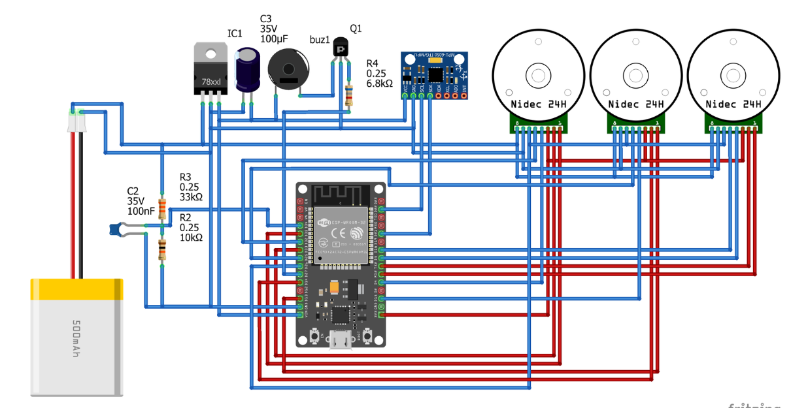

# CUBLI - Cubo Autoequilibrable

Proyecto desarrollado para el curso de Métodos Numéricos - FIEE (UNMSM).

## Descripción
Prototipo experimental de cubo autoequilibrable (Cubli) enfocado en el modelado dinámico no lineal y control automático de sistemas inestables.

## Integrantes
* Espinoza Quispe, Anthony
* Albornoz Tamayo, Gian Carlos
* Palomino Ccopa, Khevyn Jahir
* Mendoza Sanchez, Jose Fabian

## Métodos Implementados (MATLAB)
1. **Control Óptimo LQR:** Análisis de estabilidad y ubicación de polos en lazo cerrado.
2. **Caracterización de Actuadores:** Modelado no lineal y saturación de voltaje del motor (batería LiPo 12V).
3. **Estrategia de Salto:** Transferencia de momento angular (Flat to Edge).
4. **Modelado Dinámico No Lineal:** Ecuaciones de Euler-Lagrange resueltas con `ode45`.
5. **Filtro de Kalman Extendido (EKF):** Estimación cinemática de posición y velocidad.
6. **Filtro con Cuaterniones:** Estimación de orientación tridimensional (Roll, Pitch, Yaw) evitando el *gimbal lock*.

## Diagrama del Circuito

