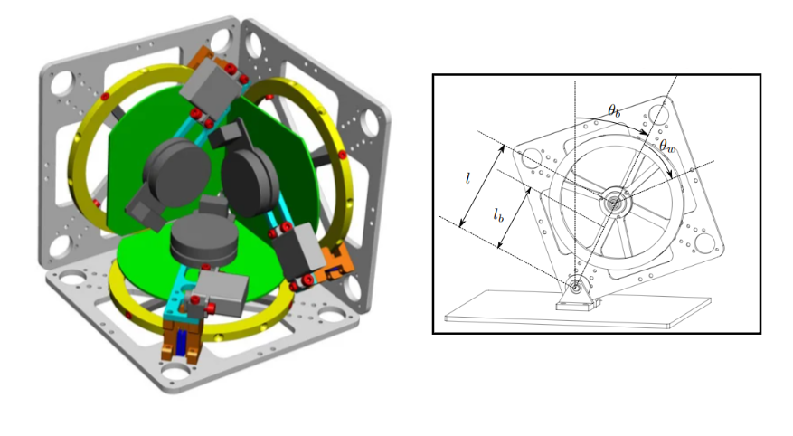

# CUBLI - Cubo Autoequilibrable

Proyecto desarrollado para el curso de Métodos Numéricos de la Facultad de Ingeniería Electrónica y Electrónica (FIEE) de la Universidad Nacional Mayor de San Marcos (UNMSM).

## Integrantes
* **Espinoza Quispe, Anthony**
* **Albornoz Tamayo, Gian Carlos**
* **Palomino Ccopa, Khevyn Jahir**
* **Mendoza Sanchez, Jose Fabian**

**Docente:** Josué Miranda  
**Facultad:** FIEE - UNMSM

---

## 1. Prototipo Experimental

### Descripción General
El sistema se implementa para resolver un problema clásico de control automático donde el sistema posee más grados de libertad que actuadores independientes. El cubo se apoya sobre uno de sus vértices, lo que lo vuelve intrínsecamente inestable.

* **Objetivo principal:** Mantener el cubo estático sobre su vértice de forma autónoma, corrigiendo instantáneamente cualquier inclinación o perturbación externa.
* **Propósito académico:** Comprender a profundidad el modelado de sistemas físicos inestables y diseñar leyes de control robustas capaces de responder en milisegundos.

### Vista del Prototipo

### Lista de Componentes y Hardware
* **Microcontrolador:** ESP32 DevKit V1 (cerebro del procesamiento y control).
* **Sensor Inercial:** Módulo GY-521 con sensor IMU MPU6050 (acelerómetro y giroscopio de 6 ejes).
* **Actuadores:** Motores *Brushless* / Nidec de alta velocidad de respuesta.
* **Mecánica:** Volantes de inercia de metal pesado acoplados a los ejes de los motores.
* **Alimentación y Energía:** Batería LiPo de 500 mAh (3.7V), condensadores y reguladores de voltaje.
* **Componentes Pasivos y Auxiliares:** Resistencias ($10\,\text{k}\Omega$, $33\,\text{k}\Omega$, $6.8\,\text{k}\Omega$) y Buzzer de alerta.

### Principio de Funcionamiento Físico
1. **Detección:** El sensor MPU6050 lee constantemente la inclinación y velocidad angular del cubo.
2. **Cálculo:** El ESP32 procesa la información de los sensores en tiempo real y determina el esfuerzo de control exacto para contrarrestar la tendencia a la caída.
3. **Contra-Torque:** Los motores aceleran bruscamente los volantes de inercia internos. Por el principio físico de acción y reacción, esta aceleración genera un contra-torque en sentido opuesto que empuja el chasis principal de vuelta a su posición vertical de equilibrio.

### Adquisición y Depuración de la Posición Espacial (IMU)
El procesamiento de la señal del MPU6050 se estructura en cuatro etapas críticas para asegurar una lectura limpia:
* **Lecturas Brutas (*Raw Data*):** Valores nativos directos entregados por los ejes del acelerómetro y giroscopio.
* **Filtrado de Ruido:** Eliminación de fluctuaciones de alta frecuencia causadas por las vibraciones mecánicas de los motores y el contacto dinámico con la superficie de apoyo.
* **Corrección de Deriva (*Drift*):** Compensación del error acumulativo que sufre el giroscopio al integrar numéricamente la velocidad angular a lo largo del tiempo.
* **Fusión Sensorial:** Combinación inteligente de datos (mediante filtros complementarios y estimadores) para estabilizar la lectura de orientación y mantener el error por debajo de $0.35^\circ$.

### Validación Experimental de Estados del Cubli en el Tiempo
Esta sección presenta el comportamiento dinámico y la evolución temporal de los estados del sistema durante la prueba de estabilización física. Las gráficas permiten contrastar la respuesta del controlador ante perturbaciones, evaluando la convergencia de los ángulos y la efectividad de la corrección inercial en el dominio del tiempo.

---

## Diagrama del Circuito Electrónico

---

## 2. Métodos Utilizados (Modelado y Simulación)

El desarrollo computacional incluye la implementación, simulación y validación de 6 métodos fundamentales para el control y la estimación matemática del sistema:

### Método 1: Control Óptimo LQR (Regulador Lineal Cuadrático)
* **Enfoque Teórico:** Modela el sistema físico linealizado en un formato de espacio de estados ($\dot{x} = Ax + Bu$). Para estabilizar este sistema intrínsecamente inestable, se diseña un Regulador Lineal Cuadrático (LQR), el cual resuelve numéricamente la Ecuación Algebraica de Riccati para encontrar la matriz óptima de ganancias de control $K$.
* **Implementación y Aporte:** Permite sintonizar de manera matemática y estructurada el compromiso entre la velocidad de respuesta del cubo y la energía consumida por los motores. En las simulaciones de MATLAB, esto asegura que los polos del sistema en lazo cerrado se ubiquen estrictamente en el semiplano izquierdo, garantizando la estabilidad asintótica del Cubli.

### Método 2: Caracterización de Actuadores y Saturación de Voltaje
* **Enfoque Teórico:** Los motores en la realidad física presentan no linealidades considerables, tales como zonas muertas de fricción estática, retrasos de respuesta y límites estrictos de alimentación impuestos por la batería LiPo.
* **Implementación y Aporte:** Se implementa un modelo matemático de saturación y funciones de transferencia no lineales (como aproximaciones mediante tangente hiperbólica y límites de tensión a $12\,\text{V}$). Esto obliga al entorno de simulación a comportarse bajo restricciones físicas reales, evitando que los comandos de control calculados teóricamente saturen o quemen los componentes al pasarlos al hardware físico del ESP32.

### Método 3: Estrategia de Salto y Transferencia de Momento Angular (*Flat-to-Edge*)
* **Enfoque Teórico:** El Cubli es capaz de levantarse por sí mismo desde una posición completamente acostada (*flat*) hasta apoyarse sobre una arista o vértice (*edge*) utilizando únicamente la conservación del momento angular.
* **Implementación y Aporte:** Se modela analíticamente la transferencia súbita de energía cinética desde los volantes de inercia hacia el cuerpo estructural principal. Mediante la simulación de perfiles de aceleración transitoria, se calcula el impulso de torque necesario para que el cubo venza la gravedad y logre la maniobra de salto de forma autónoma.

### Método 4: Ecuaciones de Euler-Lagrange (Dinámica No Lineal)
* **Enfoque Teórico:** La dinámica mecánica completa del cubo y sus ruedas se rige mediante las ecuaciones diferenciales de Euler-Lagrange, considerando las inercias de cada componente, las masas, las distancias geométricas al centro de gravedad y la fricción viscosa.
* **Implementación y Aporte:** Se programan las ecuaciones diferenciales ordinarias (EDO) del sistema en MATLAB y se resuelven numéricamente utilizando el integrador de orden superior `ode45`. Esto permite estudiar el comportamiento libre y la caída natural del péndulo invertido en lazo abierto antes de aplicar las leyes de control activo.

### Método 5: Filtro de Kalman Extendido (EKF) para Estimación Cinemática
* **Enfoque Teórico:** Los sensores del sistema están expuestos a ruidos estocásticos y las relaciones geométricas de posición suelen ser no lineales. El Filtro de Kalman Extendido (EKF) resuelve este problema linealizando localmente el modelo mediante matrices Jacobianas de derivadas parciales.
* **Implementación y Aporte:** El algoritmo opera de forma recursiva dividiéndose en dos fases: *Predicción* (proyectando el estado y la covarianza del error hacia adelante) y *Actualización* (ponderando la incertidumbre del modelo frente a las lecturas reales mediante la ganancia de Kalman). Esto permite limpiar el ruido de las mediciones y estimar la velocidad y posición con alta precisión.

### Método 6: Estimación de Orientación Tridimensional mediante Cuaterniones
* **Enfoque Teórico:** El uso de ángulos de Euler tradicionales (Roll, Pitch, Yaw) presenta limitaciones matemáticas graves como el fenómeno de bloqueo de cardán (*gimbal lock*). Para solucionarlo, se implementa una representación basada en cuaterniones de 4 parámetros ($q_w, q_x, q_y, q_z$).
* **Implementación y Aporte:** Permite un seguimiento continuo y sin singularidades de la orientación espacial del Cubli. Mediante la corrección vectorial cruzada con los datos del acelerómetro, el algoritmo compensa de manera robusta la deriva del giroscopo, logrando una estimación de actitud confiable para el control de estabilidad.

---

## Documentación
El informe, la monografía técnica y el desarrollo detallado del proyecto se encuentran adjuntos en este repositorio en el archivo **`CUBLI.pdf`**.
